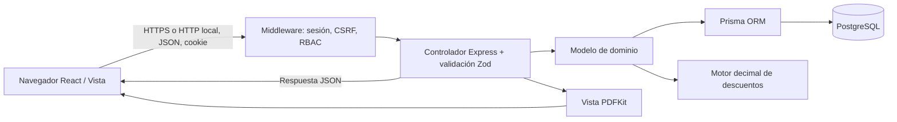

# Arquitectura de Editorial Nexus

El navegador consume una API JSON del mismo origen. Express sirve el build React y dirige `/api` a controladores. El Modelo posee todo el acceso a Prisma y las reglas del dominio. PostgreSQL es el estado persistente. No hay SQL, Prisma ni cálculo financiero en React.

## Responsabilidades

| Capa | Archivos | Responsabilidad |
|---|---|---|
| Modelo | `backend/src/models/pricing.ts` | Matriz de descuentos, impuestos, redondeo |
| Modelo | `orders.ts` | Carrito, disponibilidad, cierre transaccional, estados y reposición |
| Modelo | `quotes.ts` | Validación institucional, flujo comercial, vigencia, historial |
| Modelo | `catalog.ts`, `users.ts`, `admin.ts` | Persistencia de catálogo, usuarios, sesiones y métricas |
| Persistencia | `backend/prisma/schema.prisma`, migraciones | Entidades, relaciones y restricciones |
| Controlador | `backend/src/controllers/api.ts` | Recepción HTTP, validación, autorización, invocación del modelo y respuestas |
| Seguridad HTTP | `middleware/security.ts` | Identidad de sesión y permisos por endpoint |
| Vista | `frontend/src/views` | Formularios, tablas, navegación, estados y presentación |
| Vista PDF | `backend/src/views/quotePdf.ts` | Representación de la cotización ya calculada |

Los modelos pueden usar Prisma directamente; no se introduce un repositorio pasante que solo duplicaría métodos. El controlador no importa Prisma ni construye consultas. `app.ts` conoce códigos de errores de persistencia para traducirlos a errores HTTP genéricos, sin ejecutar consultas.

## Flujo de cierre de pedido

1. React envía POST `/api/orders`, cookie HttpOnly y encabezado CSRF.
2. Middleware recupera sesión, revisa vencimiento/actividad y exige rol comprador.
3. Controlador entrega únicamente el ID de usuario al Modelo; no acepta totales ni precios del cliente.
4. Modelo inicia transacción serializable, lee carrito/precios vigentes y descuenta stock con condición `stock >= cantidad`.
5. Motor decimal aplica descuentos secuenciales y tasa administrativa vigente.
6. Se inserta orden, líneas con precio/título históricos e historial inicial; se vacía el carrito.
7. Commit atómico. Si una línea falla, se revierte toda la operación.

Reintentos limitados para errores de serialización P2034. La orden contiene snapshot inmutable protegido también por trigger PostgreSQL. Los precios posteriores del catálogo y los cambios de IVA no recalculan órdenes anteriores.

## Seguridad

Sesiones opacas aleatorias, hash del token en base, expiración de ocho horas. Contraseñas bcrypt costo 12. Cookie HttpOnly, SameSite=Lax, Secure en producción. CSRF con token vinculado a sesión y comprobación de origen; endpoints de autenticación exigen JSON y validan origen, evitando formularios cross-site. No hay CORS abierto. Toda escritura sensible requiere rol en servidor, y la propiedad se incorpora a las consultas de órdenes/solicitudes.

Zod limita tipos, tamaños, enums y cantidades. Prisma parametriza las consultas; no se construye SQL desde entradas. React escapa texto por defecto y no usa `dangerouslySetInnerHTML`. Helmet aplica CSP y cabeceras de seguridad. Rate limit de autenticación 30 peticiones/15 minutos por IP. No se acepta asignación de rol privilegiado al registrarse. Cambiar permisos invalida sesiones existentes. Los errores al cliente no incluyen SQL, stack traces ni hashes.

## Decisiones y límites

- Aplicación monolítica modular: apropiada para tres integrantes y demo local, con menos despliegues que microservicios.
- Roles y estados como enums PostgreSQL: conjuntos cerrados tipados; no se requiere CRUD de definiciones de rol.
- Carrito como relación usuario-libro; no necesita cabecera independiente al existir exactamente uno por usuario.
- Cotización de una sola obra por solicitud: descripción, cantidad y precio forman su línea única. No se crea tabla de líneas vacía; extender a varias obras requeriría `QuoteItem`.
- No hay contabilidad ni pagos: ventas registradas suma órdenes no canceladas, incluyendo pendientes; la etiqueta no afirma ingresos cobrados.
- Semillas con ISBN y edición de demostración expresamente identificados. Portadas originales generadas como SVG, sin servicios de terceros necesarios.
- La aceptación comercial es final. Una cotización QUOTED puede revisarse; cada revisión conserva la versión anterior en historial.
- Un usuario institucional pendiente puede comprar con condiciones minoristas; solo una institución aprobada recibe 8% y puede solicitar cotizaciones.
