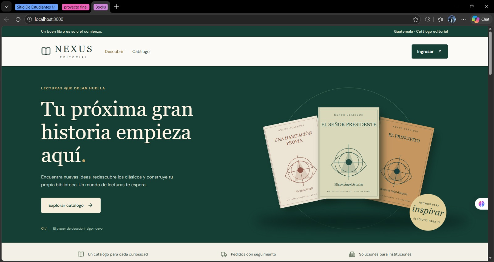
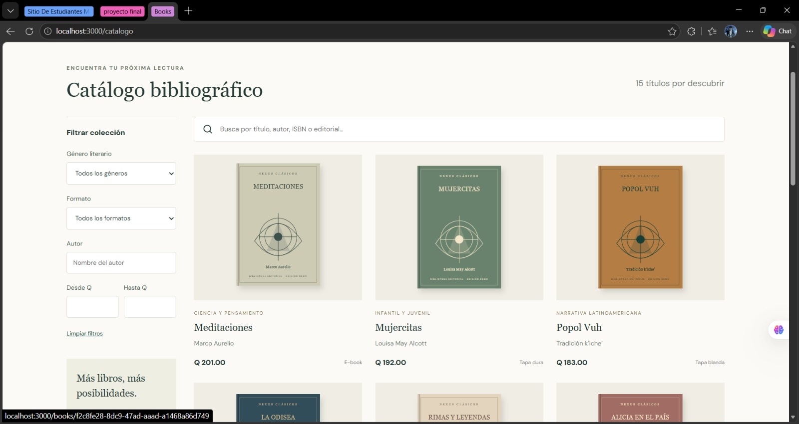
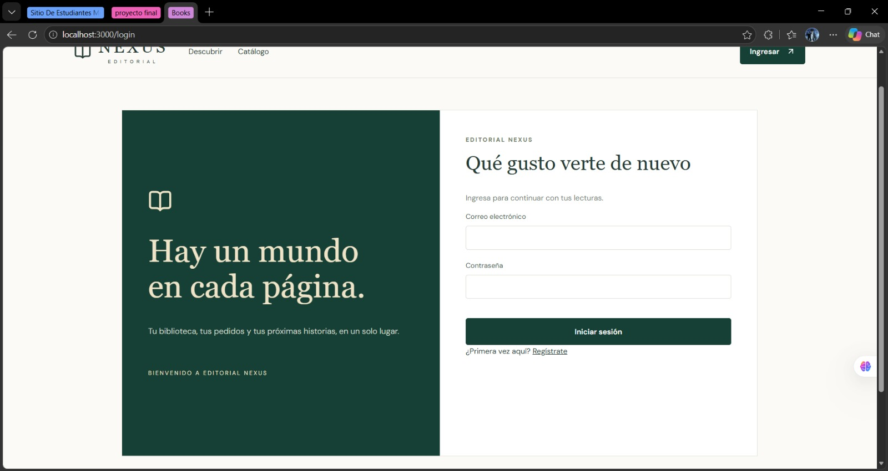

# Manual de usuario de Editorial Nexus

**Proyecto:** Editorial Nexus  
**Versión del manual:** 1.1  
**Fecha de actualización:** 19 de noviembre de 2026

## Introducción

Este manual explica cómo utilizar Editorial Nexus desde la consulta de libros hasta el registro de pedidos y la gestión de cotizaciones institucionales. Incluye los procedimientos de clientes, asesores y administradores. Los procedimientos se basan en el funcionamiento documentado de la aplicación (PauloLepe003, 2026).

Las instrucciones siguen los nombres de los botones y formularios de la aplicación. Cada procedimiento indica las condiciones necesarias y el resultado que debe observar el usuario.

## Objetivo general

Guiar al usuario en la consulta del catálogo, el registro de pedidos y la gestión de cotizaciones y funciones administrativas de Editorial Nexus.

## Objetivos específicos

- Buscar libros y consultar su disponibilidad.
- Crear una cuenta, iniciar sesión y administrar el carrito.
- Registrar pedidos y revisar su estado e importes.
- Solicitar, emitir y responder cotizaciones.
- Mantener el catálogo, los usuarios y los parámetros del sistema.

## Alcance

Editorial Nexus registra pedidos y propuestas comerciales. La confirmación de un pedido no realiza un cobro en línea. La aceptación de una cotización no inicia automáticamente una compra de catálogo ni descuenta existencias.

Las capturas ilustran el entorno de demostración. Los títulos, precios, existencias y registros pueden cambiar durante el uso.

## Contenido

- [Acceso y tipos de usuario](#acceso-y-tipos-de-usuario)
- [Catálogo y búsqueda de libros](#catálogo-y-búsqueda-de-libros)
- [Registro de cuentas](#registro-de-cuentas)
- [Inicio de sesión y perfil](#inicio-de-sesión-y-perfil)
- [Ficha del libro y carrito](#ficha-del-libro-y-carrito)
- [Confirmación y seguimiento de pedidos](#confirmación-y-seguimiento-de-pedidos)
- [Descuentos e importes](#descuentos-e-importes)
- [Solicitudes institucionales](#solicitudes-institucionales)
- [Consulta y respuesta de cotizaciones](#consulta-y-respuesta-de-cotizaciones)
- [Trabajo del asesor comercial](#trabajo-del-asesor-comercial)
- [Administración de libros e inventario](#administración-de-libros-e-inventario)
- [Autores categorías y usuarios](#autores-categorías-y-usuarios)
- [Control administrativo y parámetros](#control-administrativo-y-parámetros)
- [Solución de problemas](#solución-de-problemas)
- [Referencias](#referencias)

Los lectores pueden consultar desde **Acceso y tipos de usuario** hasta **Descuentos e importes**. Las instituciones deben revisar también **Solicitudes institucionales** y **Consulta y respuesta de cotizaciones**. Los asesores y administradores encontrarán sus procedimientos en las secciones dedicadas a sus funciones.

## Acceso y tipos de usuario

Necesita un navegador actualizado y acceso a la dirección donde esté funcionando la aplicación. En la demostración local se utiliza http://localhost:3000. La dirección localhost corresponde al mismo equipo donde se ejecuta el sistema.

La Figura 1 permite identificar los elementos de esta pantalla.

**Figura 1**

*Página de inicio de Editorial Nexus*

*Nota.* Captura de pantalla de Editorial Nexus proporcionada para este manual. Los datos visibles corresponden al entorno de demostración.

Desde Descubrir regresa al inicio; Catálogo y Explorar catálogo abren la colección. Ingresar permite identificarse. En pantallas pequeñas, utilice el botón de menú para desplegar la navegación.

La Tabla 1 resume tipos de usuario y funciones disponibles.

**Tabla 1**

*Tipos de usuario y funciones disponibles*

| Tipo de acceso | Funciones disponibles |
| --- | --- |
| Visitante | Consultar catálogo y fichas sin iniciar sesión. |
| Minorista | Usar carrito, registrar pedidos y consultar sus compras. |
| Institucional | Comprar; con aprobación, solicitar cotizaciones y recibir descuento adicional. |
| Asesor | Evaluar solicitudes y emitir o revisar cotizaciones. |
| Administrador | Gestionar catálogo, usuarios, pedidos, cotizaciones y parámetros. |

*Nota.* Elaboración propia a partir de los procedimientos y reglas de Editorial Nexus (PauloLepe003, 2026).

**Antes de comenzar:** la aplicación debe estar iniciada por el responsable del sistema. El registro público crea cuentas minoristas o institucionales; los permisos de asesor y administrador se asignan desde administración.

## Catálogo y búsqueda de libros

Puede consultar la colección sin una cuenta. Abra Catálogo desde el menú o pulse Explorar catálogo en el inicio.

La Figura 2 permite identificar los elementos de esta pantalla.

**Figura 2**

*Catálogo bibliográfico con buscador y filtros*

*Nota.* Captura de pantalla de Editorial Nexus proporcionada para este manual. Los datos visibles corresponden al entorno de demostración.

### Buscar y filtrar

1. Escriba parte del título, autor, ISBN o editorial en el buscador. Espere un momento para que se actualicen los resultados.

2. Combine Género literario, Formato y Autor para reducir la colección.

3. Indique Desde Q y Hasta Q si desea un rango de precios. El mínimo debe ser menor o igual al máximo.

4. Use Anterior y Siguiente al final de los resultados para cambiar de página.

5. Pulse Limpiar filtros para quitar los criterios y vaciar la búsqueda.

6. Seleccione la portada o el título para abrir la ficha del libro.

**Si no hay resultados:** revise la escritura, amplíe el rango de precios o limpie los filtros. La cantidad de títulos indicada corresponde a los resultados de la consulta actual.

## Registro de cuentas

Cree una cuenta para utilizar el carrito y registrar pedidos. Una cuenta institucional también permite solicitar cotizaciones cuando un administrador aprueba la institución.

### Crear una cuenta minorista

1. Pulse Ingresar y después Regístrate.

2. Escriba su Nombre completo y Correo electrónico.

3. Defina una Contraseña de al menos 10 caracteres. Si el sistema indica que supera el límite permitido, acórtela.

4. Seleccione Cliente minorista en Tipo de cuenta.

5. Pulse Crear cuenta. Si el registro es correcto, aparecerá una confirmación y se abrirá el inicio de sesión.

6. Ingrese con el correo y la contraseña que acaba de registrar.

### Crear una cuenta institucional

1. Abra Regístrate y complete el nombre, correo y contraseña.

2. Seleccione Cliente institucional en Tipo de cuenta.

3. Complete Nombre de la institución y NIT.

4. Pulse Crear cuenta y luego inicie sesión.

5. Revise el estado institucional desde su perfil. Solicite al administrador la validación de la institución.

La Tabla 2 resume estados de validación institucional.

**Tabla 2**

*Estados de validación institucional*

| Estado institucional | Efecto para el usuario |
| --- | --- |
| Pendiente | Puede comprar sin el descuento institucional. Debe esperar aprobación para solicitar cotizaciones. |
| Aprobado | Habilita las solicitudes de cotización y el descuento institucional adicional. |
| Rechazado | Las solicitudes permanecen deshabilitadas; consulte al administrador la validación de sus datos. |

*Nota.* Elaboración propia a partir de los procedimientos y reglas de Editorial Nexus (PauloLepe003, 2026).

**Correo ya registrado:** si aparece un mensaje de datos únicos existentes, utilice la cuenta que ya creó o registre un correo diferente. El registro no inicia sesión automáticamente.

### Datos de acceso

Conserve su correo y contraseña. La versión documentada no incluye una opción de recuperación ni cambio de contraseña desde la interfaz; si necesita asistencia, comuníquese con el responsable del sistema.

## Inicio de sesión y perfil

La Figura 3 permite identificar los elementos de esta pantalla.

**Figura 3**

*Formulario de inicio de sesión*

*Nota.* Captura de pantalla de Editorial Nexus proporcionada para este manual. Los datos visibles corresponden al entorno de demostración.

### Ingresar a su cuenta

1. Pulse Ingresar.

2. Escriba su Correo electrónico y Contraseña.

3. Pulse Iniciar sesión y espere la respuesta.

4. Verifique que su nombre aparezca en la parte superior. Los clientes ingresan al catálogo, el asesor al panel comercial y el administrador a su panel.

### Actualizar el nombre

Pulse su nombre en la barra superior para abrir Mi perfil. Modifique Nombre completo y pulse Guardar. La pantalla confirma la actualización. El correo y el rol se muestran como información de la cuenta.

### Cerrar sesión

Pulse el icono Cerrar sesión de la parte superior. La aplicación vuelve al inicio y muestra Ingresar. La sesión vence después de ocho horas; si el administrador modifica los permisos o el estado de su cuenta, deberá iniciar sesión nuevamente.

## Ficha del libro y carrito

Disponible para clientes minoristas e institucionales. Antes de agregar libros, inicie sesión con una de estas cuentas.

### Consultar la ficha y agregar un libro

1. Abra el Catálogo y seleccione un libro.

2. Revise el título, autor, sinopsis, precio y cantidad de ejemplares disponibles.

3. Consulte ISBN, Editorial, Año de edición y Formato en la información bibliográfica.

4. Indique una Cantidad entera mayor o igual a 1, sin superar las existencias.

5. Pulse Añadir al carrito. La confirmación Libro añadido al carrito indica que se guardó la selección.

Si todavía no ha iniciado sesión, el botón Iniciar sesión para comprar lo dirige al formulario de acceso. Después de ingresar, vuelva a abrir la ficha y agregue el libro. Si ya lo había agregado, una nueva selección suma unidades a las que tiene en el carrito.

### Cambiar cantidades o eliminar libros

1. Pulse el icono Carrito en la parte superior para abrir Tu carrito.

2. Revise los libros, precios unitarios y cantidades.

3. Cambie la cantidad de un libro y salga del campo con Tab o haciendo clic en otra parte para guardar el cambio.

4. Para quitar un libro, pulse el icono de papelera de su fila.

5. Revise el Resumen del pedido después de cada modificación. Utilice Seguir explorando para volver al catálogo.

### Qué incluye el resumen

La Tabla 3 resume conceptos del resumen del pedido.

**Tabla 3**

*Conceptos del resumen del pedido*

| Importe | Significado |
| --- | --- |
| Subtotal base | Suma de los precios unitarios multiplicados por las cantidades. |
| Volumen | Descuento según la cantidad total de ejemplares. |
| Institucional | Descuento adicional de una institución aprobada. |
| Subtotal descontado | Importe restante después de ambos descuentos. |
| IVA y Total | Impuesto configurado y resultado final del pedido. |

*Nota.* Elaboración propia a partir de los procedimientos y reglas de Editorial Nexus (PauloLepe003, 2026).

**Disponibilidad:** el carrito no reserva ejemplares. El precio y las existencias se comprueban nuevamente al confirmar el pedido. Un libro Sin stock disponible no puede agregarse.

## Confirmación y seguimiento de pedidos

### Registrar un pedido

1. Abra Tu carrito y verifique que incluya todos los libros y cantidades deseados.

2. Revise descuentos, IVA y Total en Resumen del pedido.

3. Pulse Confirmar pedido. Se abrirá un diálogo con el importe a registrar.

4. Pulse Sí, registrar pedido para continuar o Volver para revisar el carrito.

5. Espere el aviso Pedido NX seguido de su número y registrado. La aplicación abrirá Mis pedidos.

Al completarse la confirmación se registra el pedido, se descuentan los ejemplares del inventario y se vacía el carrito. No se solicita una tarjeta ni se realiza un pago en línea.

### Consultar el detalle y el historial

1. Abra Mis pedidos en el menú.

2. Localice el pedido por su número NX, fecha, estado e importe.

3. Pulse Ver detalle para consultar libros, cantidades, precios unitarios, desglose e historial.

4. Pulse Ocultar para cerrar el detalle.

La Tabla 4 resume estados de los pedidos.

**Tabla 4**

*Estados de los pedidos*

| Estado del pedido | Qué significa |
| --- | --- |
| Pendiente | Pedido registrado que espera revisión administrativa. |
| Aprobado | Pedido autorizado para continuar su atención. |
| Enviado | Pedido marcado como enviado por administración. Es un estado final. |
| Cancelado | Pedido anulado; sus unidades se restituyeron al inventario. Es un estado final. |

*Nota.* Elaboración propia a partir de los procedimientos y reglas de Editorial Nexus (PauloLepe003, 2026).

### Si la confirmación falla

Si aparece Stock insuficiente, vuelva al carrito, reduzca la cantidad o quite el libro y revise el total antes de intentar de nuevo. La operación no registra un pedido parcial cuando falla la disponibilidad de un producto.

Si se interrumpe la conexión después de confirmar, consulte primero Mis pedidos para verificar si ya existe el registro antes de repetir la compra.

**Cancelación:** la cuenta de cliente permite consultar el seguimiento. Para solicitar una cancelación, comuníquese con administración; el cambio de estado se realiza desde el panel administrativo.

## Descuentos e importes

El sistema suma las unidades de todos los títulos para determinar el descuento por volumen. No necesita introducir un cupón.

La Tabla 5 resume descuentos por volumen.

**Tabla 5**

*Descuentos por volumen*

| Ejemplares totales | Descuento por volumen |
| :---: | :---: |
| 1 a 5 | 0 % |
| 6 a 20 | 5 % |
| 21 a 50 | 10 % |
| 51 o más | 15 % |

*Nota.* Elaboración propia a partir de los procedimientos y reglas de Editorial Nexus (PauloLepe003, 2026).

### Descuento institucional e impuesto

Una cuenta institucional aprobada recibe 8 % adicional sobre el importe que queda después del descuento por volumen. Las instituciones pendientes no reciben este beneficio. El IVA se aplica sobre el subtotal ya descontado; su tasa inicial es 12 % y el administrador puede modificarla.

### Ejemplo de un pedido institucional

Suponga una institución aprobada que solicita 25 ejemplares a Q100.00 cada uno, con IVA configurado en 12 %. Es un ejemplo de cálculo; los precios reales se consultan en la aplicación.

La Tabla 6 resume ejemplo del cálculo de un pedido institucional.

**Tabla 6**

*Ejemplo del cálculo de un pedido institucional*

| Concepto | Cálculo | Importe |
| --- | --- | ---: |
| Subtotal base | 25 × Q100.00 | Q2,500.00 |
| Descuento por volumen | 10 % de Q2,500.00 | −Q250.00 |
| Después del volumen | Q2,500.00 − Q250.00 | Q2,250.00 |
| Descuento institucional | 8 % de Q2,250.00 | −Q180.00 |
| Subtotal descontado | Q2,250.00 − Q180.00 | Q2,070.00 |
| IVA | 12 % de Q2,070.00 | Q248.40 |
| Total | Q2,070.00 + Q248.40 | Q2,318.40 |

*Nota.* Elaboración propia a partir de los procedimientos y reglas de Editorial Nexus (PauloLepe003, 2026).

Los porcentajes se aplican uno después del otro. En este ejemplo, 10 % por volumen y 8 % institucional equivalen a un descuento conjunto efectivo de 17.2 % antes de IVA.

**Importes históricos:** el detalle de un pedido conserva los precios y el desglose aplicados al registrarlo. Los cambios posteriores de precio o IVA no recalculan ese pedido.

## Solicitudes institucionales

Este módulo está disponible para cuentas institucionales aprobadas. Permite solicitar ediciones especiales, impresión bajo demanda o cantidades que superan el inventario del catálogo.

### Enviar una solicitud

1. Inicie sesión con su cuenta institucional.

2. Seleccione Cotizaciones en el menú. Se abrirá Mis cotizaciones.

3. Pulse Nueva solicitud +.

4. Complete los campos de Nueva solicitud institucional según la tabla siguiente.

5. Pulse Enviar solicitud y espere el aviso Solicitud enviada al equipo comercial.

6. Verifique que aparezca la tarjeta de la nueva solicitud con estado Pendiente.

La Tabla 7 resume campos de una solicitud institucional.

**Tabla 7**

*Campos de una solicitud institucional*

| Campo | Qué debe ingresar |
| --- | --- |
| Obra o título solicitado | Nombre de la obra o del proyecto que desea cotizar. |
| Cantidad estimada | Número entero de ejemplares, como mínimo 1. |
| Fecha requerida | Fecha futura en que necesita el trabajo; seleccione como mínimo el día siguiente. |
| Acabado de portada | Características deseadas; por ejemplo, tapa dura con laminado mate. |
| Tipo de papel | Especificación solicitada; por ejemplo, papel bond de 80 g. |
| Observaciones adicionales | Información complementaria. Puede dejar este campo vacío. |

*Nota.* Elaboración propia a partir de los procedimientos y reglas de Editorial Nexus (PauloLepe003, 2026).

### Revisar lo enviado

Seleccione la tarjeta o Ver solicitud. Consulte el cliente, institución, cantidad, portada, papel y fecha requerida. La sección Trazabilidad de la solicitud permite revisar las acciones registradas.

**Institución sin validar:** si Nueva solicitud + está deshabilitado, consulte el estado en Mi perfil y solicite revisión al administrador. La cuenta pendiente puede realizar compras de catálogo sin el descuento institucional.

La cantidad y el precio de una propuesta pueden ser ajustados por el asesor. Revise siempre la cotización final antes de aceptarla.

## Consulta y respuesta de cotizaciones

### Revisar una propuesta y descargarla

1. Abra Cotizaciones y seleccione la solicitud que tenga estado Cotizado.

2. Revise descripción, cantidad cotizada, precio unitario, descuentos, IVA, total y fecha de vigencia.

3. Pulse Descargar PDF. Se abrirá el documento en otra pestaña; puede usar el control de descarga del visor del navegador para guardarlo.

4. Compare los datos del documento con las condiciones que necesita antes de responder.

### Aceptar o rechazar la propuesta

1. En el detalle de una solicitud Cotizada, pulse Aceptar propuesta o Rechazar propuesta.

2. Revise la pregunta de confirmación y pulse Confirmar decisión. Use Volver para cancelar esa decisión antes de enviarla.

3. Espere el mensaje Tu respuesta ha sido registrada.

4. Verifique el estado actualizado y revise Trazabilidad de la solicitud si necesita consultar el registro.

La Tabla 8 resume estados de las solicitudes y cotizaciones.

**Tabla 8**

*Estados de las solicitudes y cotizaciones*

| Estado de la solicitud | Significado |
| --- | --- |
| Pendiente | La institución envió el requerimiento y espera evaluación. |
| Cotizado | Existe una propuesta emitida que espera respuesta del cliente. |
| Aceptado | El cliente confirmó la propuesta. La solicitud queda cerrada. |
| Rechazado | La propuesta fue rechazada por el cliente o la solicitud fue rechazada por el asesor. Queda cerrada. |

*Nota.* Elaboración propia a partir de los procedimientos y reglas de Editorial Nexus (PauloLepe003, 2026).

### Vigencia y efecto de la aceptación

Una propuesta vencida no puede aceptarse. Solicite una revisión al asesor si necesita una nueva vigencia. Para aceptar, la institución también debe conservar su estado de aprobación.

La aceptación registra el acuerdo comercial. No descuenta inventario ni genera automáticamente un pedido de catálogo, ya que puede tratarse de una obra que todavía debe imprimirse. La producción y el cobro se coordinan fuera de este flujo.

**Descarga disponible:** el PDF se habilita cuando existe una cotización emitida. Una solicitud pendiente sin propuesta todavía no tiene documento para descargar.

## Trabajo del asesor comercial

Disponible para asesores y administradores. Al iniciar sesión como asesor, se abre el Panel comercial con la pantalla Solicitudes y cotizaciones.

### Evaluar y emitir una cotización

1. Abra Panel comercial y seleccione una solicitud Pendiente.

2. Revise institución, cantidad estimada, acabado de portada, papel, fecha requerida y observaciones.

3. Pulse Emitir cotización.

4. Complete Descripción de la propuesta y verifique Cantidad cotizada.

5. Ingrese Precio unitario Q, mayor que cero, y una fecha futura en Válida hasta.

6. Pulse Guardar y emitir cotización.

7. Revise el desglose calculado y compruebe que la solicitud cambie a Cotizado. La institución podrá consultar la propuesta y descargar su PDF.

### Revisar una propuesta emitida

1. Abra una solicitud Cotizada que todavía no tenga una respuesta final.

2. Pulse Revisar cotización.

3. Actualice descripción, cantidad, precio unitario o vigencia según corresponda.

4. Pulse Guardar y emitir cotización y revise los importes actualizados.

5. Abra Trazabilidad de la solicitud para consultar las acciones y las versiones registradas.

### Rechazar una solicitud

1. Abra una solicitud Pendiente o Cotizada.

2. Pulse Rechazar solicitud.

3. Escriba el Motivo del rechazo.

4. Pulse Confirmar rechazo y verifique el estado Rechazado.

**Solicitudes cerradas:** las aceptadas y rechazadas no permiten emitir otra propuesta sobre el mismo registro. Los descuentos y el impuesto se calculan al emitir o revisar la cotización.

Los asesores no registran la decisión en nombre de la institución. La respuesta se realiza desde la cuenta institucional correspondiente.

## Administración de libros e inventario

Inicie sesión como administrador y abra Administración. En el menú lateral seleccione Libros e inventario.

### Crear un libro

1. Pulse Nuevo libro +.

2. Complete Título, ISBN de 13 dígitos y Año de edición.

3. Escriba la Sinopsis y un Precio Q mayor que cero.

4. Indique Stock como un número entero mayor o igual a cero.

5. Seleccione Editorial, Formato y al menos un Autor y una Categoría activos. Para seleccionar varios, mantenga Ctrl en Windows o Cmd en macOS.

6. Indique una Portada mediante una URL HTTPS o una ruta local de portada SVG ya disponible, como /covers/book-1.svg. Puede dejar el campo vacío.

7. Mantenga Activo para publicar el libro; marque Destacado si desea incluirlo en la selección del inicio.

8. Pulse Guardar y espere Libro guardado. Compruebe el registro en la lista y en el catálogo público si está activo.

### Editar precio o existencias

1. Utilice el buscador de administración para localizar el libro por título, autor, ISBN o editorial.

2. Pulse Editar.

3. Modifique los campos necesarios y pulse Guardar.

4. Verifique el precio, stock y estado mostrados en la lista.

**Ajuste de inventario:** Stock representa la existencia total actual. Si había 10 unidades y llegaron 5 más, escriba 15. Guardar el valor 5 dejaría únicamente 5 unidades registradas.

### Desactivar o reactivar

Pulse Desactivar junto al libro y confirme en el diálogo. El libro deja de estar disponible en el catálogo público, mientras los pedidos históricos se conservan. Para reactivarlo, pulse Editar, marque Activo y guarde.

La administración incluye libros activos e inactivos. El campo de portada asocia una imagen por dirección; no permite seleccionar ni subir un archivo desde el equipo.

## Autores categorías y usuarios

### Gestionar autores y categorías

1. En Administración, seleccione Autores o Categorías.

2. Pulse Crear +.

3. Ingrese Nombre y, si corresponde, Biografía para un autor o Descripción para una categoría.

4. Mantenga Activo y pulse Guardar.

5. Para modificar un registro existente, pulse Editar, actualice sus datos y guarde.

Para desactivar un autor o una categoría, pulse Desactivar y confirme. Para reactivar, abra Editar, marque Activo y guarde. Los registros inactivos dejan de estar disponibles como opciones activas para nuevas asignaciones; se conservan sus referencias existentes.

### Buscar y administrar una cuenta

1. Seleccione Usuarios en el menú administrativo.

2. Busque a la persona por nombre o correo.

3. Pulse Gestionar en la fila de la cuenta.

4. Seleccione el Rol que corresponda. Mantenga Cuenta activa para permitir el acceso o desmárquela para inhabilitarlo.

5. Si la cuenta tiene institución registrada, revise el NIT y elija Pendiente, Aprobado o Rechazado en Validación institucional.

6. Pulse Guardar y compruebe el rol y los estados en la lista.

### Aprobar una institución

Localice la cuenta institucional, pulse Gestionar y seleccione Aprobado en Validación institucional. Guarde el cambio y pida al usuario que vuelva a iniciar sesión. La aprobación habilita el descuento institucional y el envío de solicitudes de cotización.

La Tabla 9 resume efectos de los cambios de una cuenta.

**Tabla 9**

*Efectos de los cambios de una cuenta*

| Cambio administrativo | Efecto |
| --- | --- |
| Rol o validación institucional | Ajusta las funciones y beneficios de la cuenta. |
| Cuenta inactiva | Impide iniciar sesión con ese usuario. |
| Guardar cambios de usuario | Cierra sus sesiones anteriores; debe ingresar nuevamente. |

*Nota.* Elaboración propia a partir de los procedimientos y reglas de Editorial Nexus (PauloLepe003, 2026).

**Cuenta del administrador:** el botón Gestionar está deshabilitado en su propia fila. Esta pantalla no permite quitarse los permisos a sí mismo. El rol institucional solo se ofrece si la cuenta tiene una institución registrada.

## Control administrativo y parámetros

### Consultar el resumen

En Resumen se muestran ventas registradas, pedidos, libros activos, usuarios, solicitudes pendientes y cotizaciones emitidas. Inventario que necesita atención lista los libros con 10 ejemplares o menos.

Ventas registradas suma los importes de los pedidos no cancelados. Es un indicador de pedidos registrados; no representa confirmación de dinero cobrado por una pasarela de pago.

### Cambiar el estado de un pedido

1. Abra Pedidos en el menú administrativo.

2. Use Filtrar por estado si desea limitar los registros.

3. Localice el pedido y pulse Ver detalle.

4. Revise los productos, importes e historial y seleccione la acción disponible.

5. Lea el nuevo estado en el diálogo y pulse Confirmar cambio.

La Tabla 10 resume cambios permitidos en los estados de los pedidos.

**Tabla 10**

*Cambios permitidos en los estados de los pedidos*

| Estado actual | Cambios permitidos |
| --- | --- |
| Pendiente | Aprobado o Cancelado |
| Aprobado | Enviado o Cancelado |
| Enviado | Sin cambios posteriores |
| Cancelado | Sin cambios posteriores |

*Nota.* Elaboración propia a partir de los procedimientos y reglas de Editorial Nexus (PauloLepe003, 2026).

Cancelar un pedido pendiente o aprobado restituye sus unidades al inventario una sola vez. Un pedido enviado ya no puede cancelarse desde este flujo. Cada cambio se incorpora al historial.

### Modificar la tasa de IVA

1. Abra Parámetros.

2. En Tasa de IVA escriba el valor decimal entre 0 y 1. Por ejemplo, 0.12 representa 12 %.

3. Pulse Guardar y espere Parámetros actualizados.

4. Compruebe la tasa en un nuevo cálculo antes de continuar la operación.

La nueva tasa se aplica a pedidos nuevos y a nuevas versiones de cotizaciones. Los importes de pedidos y cotizaciones ya registrados conservan su desglose mientras no se emita una nueva versión de la propuesta.

**Panel comercial:** el administrador puede acceder a Cotizaciones desde su menú lateral y utilizar los mismos procedimientos de emisión y revisión descritos para el asesor.

## Solución de problemas

Revise el mensaje mostrado antes de repetir una acción. Si el problema continúa, informe al responsable del sistema la pantalla, operación realizada y texto del error; no envíe su contraseña.

La Tabla 11 resume problemas frecuentes y acciones recomendadas.

**Tabla 11**

*Problemas frecuentes y acciones recomendadas*

| Situación o mensaje | Acción recomendada |
| --- | --- |
| La página no abre | Compruebe la dirección y que la aplicación esté iniciada. localhost funciona en el equipo donde está ejecutándose el sistema. |
| Correo o contraseña incorrectos | Revise el correo y la contraseña. Si la cuenta fue desactivada o no recuerda el acceso, consulte al administrador. |
| Demasiados intentos | Espere los 15 minutos indicados antes de volver a ingresar o registrarse. |
| No hay libros con estos filtros | Pulse Limpiar filtros, corrija la búsqueda o amplíe el rango de precios. |
| Stock insuficiente | Vuelva al carrito, ajuste cantidades o elimine el producto y confirme nuevamente. |
| No tienes permiso o acceso | Verifique el rol de la cuenta. Inicie sesión con la cuenta autorizada para esa operación. |
| Nueva solicitud deshabilitada | Revise la validación institucional en Mi perfil y solicite aprobación al administrador. |
| Cotización expirada | Solicite al asesor una revisión con una nueva fecha de vigencia. |
| Inicia sesión o Token CSRF inválido | Recargue la página e inicie sesión nuevamente. Los cambios administrativos pueden cerrar sesiones anteriores. |
| Ya existe un registro con esos datos | Revise si el correo, ISBN o nombre ya están registrados y corrija el campo correspondiente. |

*Nota.* Elaboración propia a partir de los procedimientos y reglas de Editorial Nexus (PauloLepe003, 2026).

### Uso cotidiano

Espere mientras un formulario muestra Procesando. En los diálogos, use × o Escape para cerrar y Tab para recorrer los campos. Antes de confirmar un pedido o una propuesta, revise cantidades, importes y fechas.

## Referencias

PauloLepe003. (2026). *Editorial Nexus* (revisión 076b9e7) [Código fuente]. GitHub. https://github.com/PauloLepe003/ProyectoFinalArquitectura-EditorialNexus/tree/076b9e7029827e847894643cd7241608f080812f
