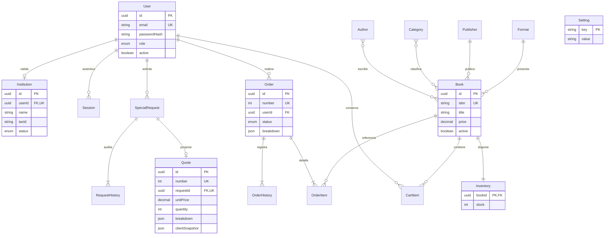

# Modelo relacional

Prisma crea tablas puente `_AuthorToBook` y `_BookToCategory`. Las PK son UUID excepto claves naturales de parámetros y claves compuestas del carrito. ISBN y correo son únicos. Las FK impiden referencias inexistentes; libros, autores y categorías usan eliminación lógica. Las tablas de sesión y carrito dependen del usuario con eliminación en cascada; no existe endpoint de borrado físico de usuarios.

`Role`, `Validation`, `OrderStatus` y `RequestStatus` son tipos enum cerrados, no texto libre. `actorId` de historial es identificador de auditoría, conservado aunque una identidad cambie; los usuarios se desactivan, nunca se borran desde la aplicación. Los timestamps son generados por la base. Se muestran al usuario en su zona local; los PDF usan fecha ISO para evitar ambigüedad.

Los snapshots JSON de importes, cliente y versiones son una desnormalización deliberada para preservar evidencias históricas. Las relaciones operativas siguen normalizadas. No se usa JSON como sustituto de libros, usuarios, inventario o carritos.

Restricciones CHECK impiden cantidades/precios no positivos y stock negativo. Índices cubren sesión por expiración, solicitudes por propietario/estado, órdenes por usuario/fecha/estado, libro activo/fecha y usuario por rol/actividad. Las búsquedas de subcadenas usan `ILIKE` mediante Prisma; con un catálogo mucho mayor convendría un índice `pg_trgm` y límites de consulta adicionales.

El script SQL completo está en `database/schema.sql`; la misma definición inicial y restricciones están versionadas en `backend/prisma/migrations/202611090001_initial/migration.sql`. `seed.sql` contiene solo datos de demostración y hashes bcrypt, nunca sesiones.
